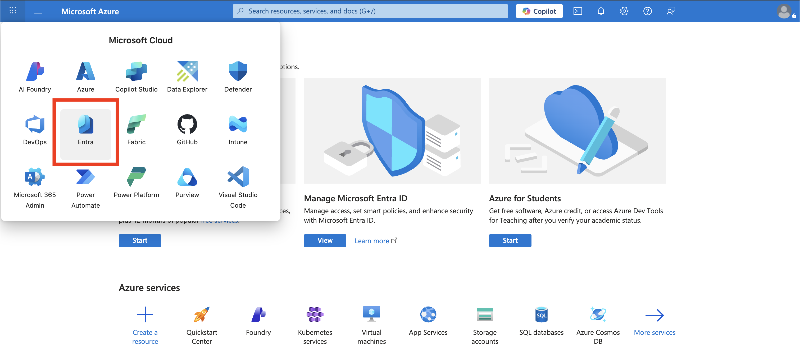
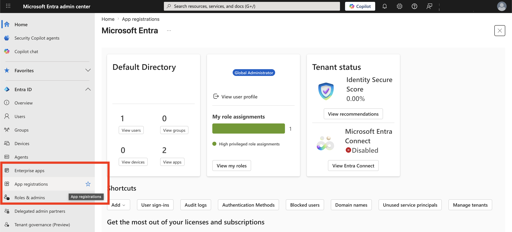
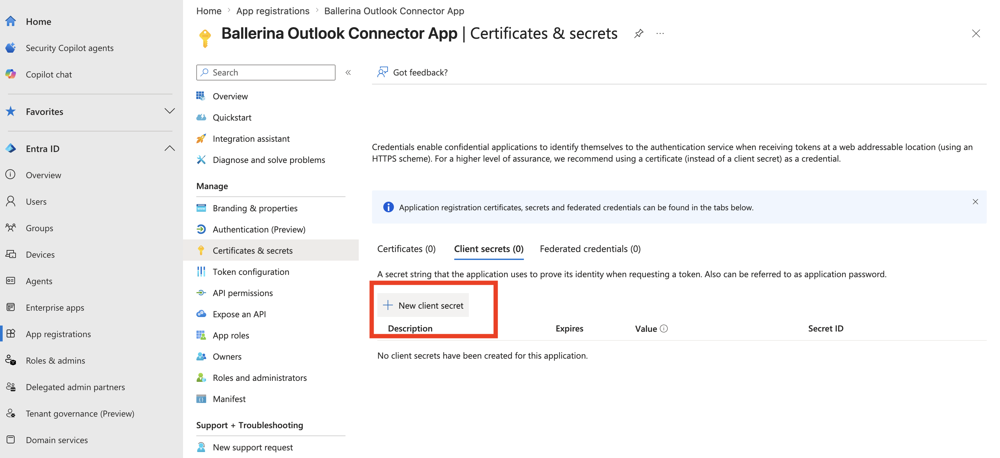

## Overview

[Azure Key Vault](https://azure.microsoft.com/en-us/products/key-vault/) is a Microsoft Azure cloud service for safely storing and accessing secrets, cryptographic keys, certificates and managed storage-account keys, with access governed by Microsoft Entra ID.

The Azure Key Vault connector exposes the Key Vault data-plane REST API to Ballerina programs. It has the same operation surface as API version 7.0, and covers all 78 of its operations: key management and cryptography, secrets, certificates and certificate issuers, and managed storage accounts with their SAS definitions, including soft-delete, recovery, backup and restore.

### Key features

- Create, import, rotate and back up cryptographic keys, and use them to encrypt, decrypt, sign, verify, wrap and unwrap data without the private key leaving the vault
- Store, version, update and rotate secrets such as passwords, connection strings and API keys
- Issue and import certificates, manage their policies, issuers and contacts, and follow pending certificate operations
- Manage Key Vault-managed storage accounts, key regeneration and SAS definitions
- Recover or purge soft-deleted keys, secrets, certificates and storage accounts

## Setup guide

To use the Azure Key Vault connector, you need a key vault, permission to use it, and an application registered in Microsoft Entra ID.

### Step 1: Sign in to the Azure portal

1. Go to the [Azure portal](https://portal.azure.com/).
2. Sign in with an account that has an active subscription.

### Step 2: Create a key vault

1. Search for **Key vaults** and select **Create**.
2. Choose a subscription, resource group, region and a globally unique vault name.
3. Create the vault.
4. Note the **Vault URI** on the vault's **Overview** page, for example `https://<vault-name>.vault.azure.net`. The connector sends every request to this URI.

### Step 3: Grant data-plane access

1. On a vault that uses Azure role-based access control, open the vault's **Access control (IAM)** page.
2. Assign the roles the program needs to the user account that will sign in during Step 4, for example:
    - **Key Vault Secrets Officer** to manage secrets
    - **Key Vault Crypto Officer** to manage keys and use them for cryptographic operations
    - **Key Vault Certificates Officer** to manage certificates

On a vault that uses access policies, add an access policy with the matching key, secret and certificate permissions instead.

### Step 4: Obtain a refresh token

The connector authenticates with an OAuth 2.0 refresh token from Microsoft Entra ID and renews its access token automatically.

1. In the Azure portal, open the app launcher and select **Entra**.

    

2. Go to **App registrations** > **New registration**. Enter a name, choose the supported account types, add `https://jwt.ms` as a **Web** redirect URI, and select **Register**.

    

3. On the application's **Overview** page, note the **Application (client) ID** and the **Directory (tenant) ID**.
4. Go to **Certificates & secrets** > **New client secret**, add a secret, and copy its **Value**. The value is shown only once.

    

5. Go to **API permissions** > **Add a permission** > **Azure Key Vault**, select the delegated **user_impersonation** permission, and select **Add permissions**. Grant admin consent if your tenant requires it.
6. Open the following URL in a browser, with your tenant ID and client ID, and sign in with the user account that has the role from Step 3:

    ```text
    https://login.microsoftonline.com/<tenant-id>/oauth2/v2.0/authorize?client_id=<client-id>&response_type=code&redirect_uri=https%3A%2F%2Fjwt.ms&response_mode=query&scope=https%3A%2F%2Fvault.azure.net%2Fuser_impersonation%20offline_access
    ```

7. Accept the consent prompt. The browser opens `https://jwt.ms/?code=<authorization-code>`. Copy the `code` value, which is single-use and expires within minutes.
8. Exchange the code for a refresh token:

    ```bash
    curl -X POST "https://login.microsoftonline.com/<tenant-id>/oauth2/v2.0/token" \
      --data-urlencode "client_id=<client-id>" \
      --data-urlencode "client_secret=<client-secret>" \
      --data-urlencode "scope=https://vault.azure.net/user_impersonation offline_access" \
      --data-urlencode "code=<authorization-code>" \
      --data-urlencode "redirect_uri=https://jwt.ms" \
      --data-urlencode "grant_type=authorization_code"
    ```

9. Copy the `refresh_token` value from the JSON response.

## Quickstart

To use the Azure Key Vault connector in your Ballerina application, update the `.bal` file as follows:

### Step 1: Import the module

Import the `azure.keyvault` module.

```ballerina
import ballerinax/azure.keyvault;
```

### Step 2: Instantiate a new connector

Create a `keyvault:Client` with the vault URI and the credentials from step 4 of the setup guide.

```ballerina
configurable string keyVaultUrl = ?;
configurable string tenantId = ?;
configurable string clientId = ?;
configurable string clientSecret = ?;
configurable string refreshToken = ?;

final keyvault:Client keyVault = check new ({
    auth: {
        clientId,
        clientSecret,
        refreshToken,
        refreshUrl: string `https://login.microsoftonline.com/${tenantId}/oauth2/v2.0/token`,
        scopes: ["https://vault.azure.net/user_impersonation", "offline_access"]
    }
}, keyVaultUrl);
```

> **Note:** The connector's default token URL is the multi-tenant `https://login.microsoftonline.com/common/oauth2/v2.0/token` endpoint. It works only for applications that accept accounts from any organization, so change it to your tenant's endpoint, as `refreshUrl` does above.

Provide the values in a `Config.toml` file:

```toml
keyVaultUrl = "https://<vault-name>.vault.azure.net"
tenantId = "<tenant-id>"
clientId = "<client-id>"
clientSecret = "<client-secret>"
refreshToken = "<refresh-token>"
```

### Step 3: Invoke the connector operation

Store a secret in the vault. Every operation takes the Key Vault REST API version as `apiVersion`.

```ballerina
public function main() returns error? {
    keyvault:SecretBundle _ = check keyVault->setSecret("db-password", {value: "s3cr3t-value"}, apiVersion = "7.0");
}
```

### Step 4: Run the Ballerina application

```bash
bal run
```

## Examples

The Azure Key Vault connector provides practical examples illustrating usage in various scenarios. Explore these [examples](https://github.com/ballerina-platform/module-ballerinax-azure.keyvault/tree/main/examples/), covering the following use cases:

1. [Secret rotation workflow](https://github.com/ballerina-platform/module-ballerinax-azure.keyvault/tree/main/examples/secret_rotation_workflow) - Store a new secret version and disable the older ones.
2. [Sensitive payload encryption](https://github.com/ballerina-platform/module-ballerinax-azure.keyvault/tree/main/examples/sensitive_payload_encryption) - Create an RSA key and encrypt and decrypt a payload with it.
3. [Document signing and verification](https://github.com/ballerina-platform/module-ballerinax-azure.keyvault/tree/main/examples/document_signing_verification) - Sign a document digest with a vault key and verify the signature.
4. [Self-signed certificate provisioning](https://github.com/ballerina-platform/module-ballerinax-azure.keyvault/tree/main/examples/self_signed_certificate_provisioning) - Issue a self-signed certificate and inspect its policy and versions.
